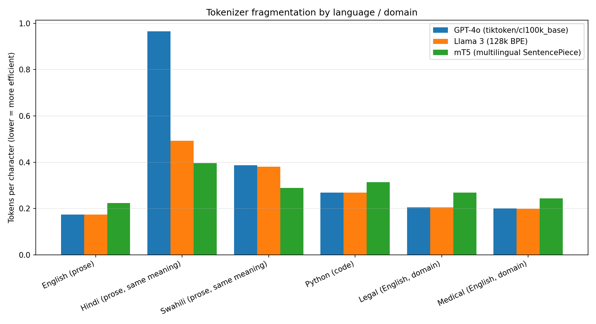
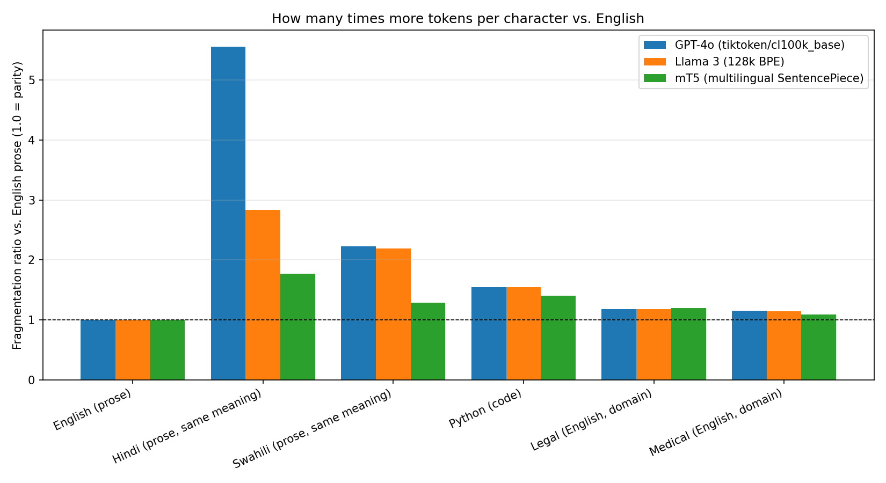

# Tokenizer Efficiency & Cost Impact Across Languages and Domains

How much more do you pay for the *same* content just because of which language or
domain it's in? This project tokenizes matched text samples — English prose, Hindi,
Swahili, Python code, legal text, and medical text — across three tokenizers, measures
fragmentation (tokens per character), and translates the gap into a $ cost impact.

**Headline finding:** on GPT-4o's tokenizer, Hindi text uses **5.6x more tokens** than
equivalent English text for the same underlying content — meaning ~5.6x the API cost,
purely from tokenization, before any pricing differences are even considered.

## Setup / constraints

- Runs entirely on **Google Colab Free** (CPU is enough — no GPU needed)
- **No paid API, no API key required.** All three tokenizers are free, public, and
  ungated:
  - **GPT-4o** — `tiktoken`, `cl100k_base`
  - **Llama 3** — `NousResearch/Meta-Llama-3-8B` (an ungated mirror of the official
    Llama 3 tokenizer, so no HuggingFace login/token is needed)
  - **mT5** — `google/mt5-small`, a SentencePiece tokenizer trained across 101
    languages

## How it works

1. Six fixed text samples are tokenized by all three tokenizers:
   - English prose (health-advice paragraph)
   - Hindi — a close paraphrase of the same paragraph
   - Swahili — a close paraphrase of the same paragraph
   - Python code
   - Legal boilerplate (English)
   - Medical clinical note (English)
2. For each (tokenizer, category) pair the script computes `tokens_per_char` and
   `tokens_per_word`, then a **fragmentation ratio vs. English** on the same
   tokenizer (`tokens_per_char[category] / tokens_per_char[English]`).
3. Token counts are converted to a $ cost using a shared reference price
   ($2.50 / 1M input tokens, GPT-4o's published rate) applied uniformly across all
   three tokenizers — this isolates the pure tokenization-efficiency effect on cost,
   since the price per token is held constant. A second column applies each
   tokenizer's own "native" price for comparison.
4. Two bar charts and two CSVs are produced (see [`results/`](./results)).

## Repo structure

```
.
├── tokenizer_efficiency_analysis.py   # the full analysis script (run in Colab)
├── requirements.txt
├── results/                           # sample output from a real run
│   ├── tokenizer_fragmentation_results.csv
│   ├── tokenizer_cost_impact.csv
│   ├── fragmentation_by_category.png
│   └── fragmentation_ratio_vs_english.png
└── LICENSE
```

## Usage

Open a new [Google Colab](https://colab.research.google.com/) notebook, then:

```python
!pip install -q tiktoken transformers sentencepiece pandas matplotlib
```

Paste the contents of `tokenizer_efficiency_analysis.py` into the next cell (or
upload the file and `%run tokenizer_efficiency_analysis.py`) and run it top to
bottom. It will print two tables and save four files
(`tokenizer_fragmentation_results.csv`, `tokenizer_cost_impact.csv`,
`fragmentation_by_category.png`, `fragmentation_ratio_vs_english.png`).

To run it locally instead of Colab:

```bash
pip install -r requirements.txt
python tokenizer_efficiency_analysis.py
```

## Results

### Fragmentation ratio vs. English (same tokenizer)

| Category | GPT-4o (tiktoken) | Llama 3 | mT5 (multilingual) |
|---|---|---|---|
| Hindi | **5.56x** | 2.83x | 1.77x |
| Swahili | 2.23x | 2.19x | 1.29x |
| Python code | 1.55x | 1.55x | 1.40x |
| Legal (English) | 1.18x | 1.18x | 1.20x |
| Medical (English) | 1.16x | 1.14x | 1.09x |

Full numeric output: [`results/tokenizer_fragmentation_results.csv`](./results/tokenizer_fragmentation_results.csv)
· cost table: [`results/tokenizer_cost_impact.csv`](./results/tokenizer_cost_impact.csv)




### Takeaways

- **Worst case:** Hindi on GPT-4o's tokenizer — a 5.6x cost multiplier from
  tokenization alone.
- **Best mitigation:** a multilingual-aware tokenizer (mT5) cuts that same Hindi
  penalty by ~68% (5.56x → 1.77x), and the Swahili penalty from 2.23x → 1.29x.
- **Language effects dwarf domain effects.** The worst language penalty (5.6x) is
  roughly 5x larger than the worst domain-jargon penalty (1.2x for legal/medical
  text). If you're optimizing cost for non-English users, tokenizer choice matters
  far more than prompt or domain engineering.
- Llama 3's larger 128k-token vocabulary gives it better non-English coverage than
  GPT-4o's `cl100k_base`, but it still trails a dedicated multilingual tokenizer
  like mT5.

## Limitations / notes for reproducing this rigorously

- **Translation quality:** the Hindi and Swahili paragraphs are close paraphrases
  written for this benchmark, not certified/professional translations. For
  publication-grade rigor, swap them for a verified parallel corpus such as
  [FLORES-200](https://github.com/facebookresearch/flores), which provides the same
  sentences across 200 languages.
- **Word-count metrics** (`tokens_per_word`) assume whitespace-delimited languages.
  Hindi and Swahili qualify, but if you extend this to Chinese, Japanese, or Thai,
  swap in a proper word segmenter — whitespace splitting won't work.
- **Pricing constants** in the script are editable. The Llama 3 "native price" is an
  illustrative open-weight hosting rate and varies significantly by provider — edit
  `NATIVE_PRICE_PER_1K_TOKENS` in the script to match whatever you're actually
  billed.
- Sample size is small (one paragraph per language/domain) by design, to keep the
  experiment runnable end-to-end on Colab Free in under a minute. Scale up the
  `SAMPLES` dict with more/longer texts per category for a more statistically
  robust result.


